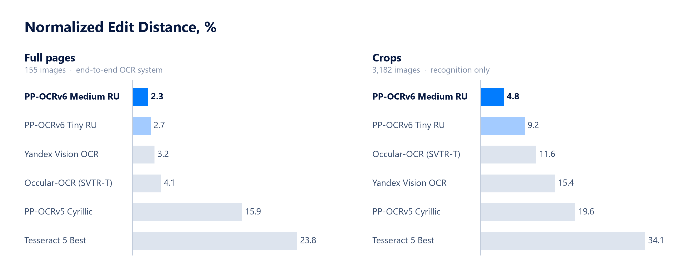

  
   
  
  

## Быстрые OCR-модели PP-OCRv6, дообученные для распознавания текста на русском языке, включая рукописный.

Результаты на [ru-ocr-benchmark-hard](https://huggingface.co/datasets/vladlinv/ru-ocr-benchmark-hard) — бенчмарке со сложными примерами, включая искажения, дефекты печати и изображения низкого качества.

## Использование

### 🚀 Рекомендуемые для CPU (RapidOCR / ONNX)
* [**RapidOCR (PP-OCRv6 Medium RU)**](https://huggingface.co/vladlinv/PP-OCRv6_medium_rec_ru_onnx)
* [**RapidOCR (PP-OCRv6 Tiny RU)**](https://huggingface.co/vladlinv/PP-OCRv6_tiny_rec_ru_onnx)

### 🚀 Рекомендуемые для GPU (PaddlePaddle)
* [**PP-OCRv6 Medium RU**](https://huggingface.co/vladlinv/PP-OCRv6_medium_rec_ru)
* [**PP-OCRv6 Tiny RU**](https://huggingface.co/vladlinv/PP-OCRv6_tiny_rec_ru)

## Детали
PP-OCRv6 — линейка легковесных распознавателей текста PaddlePaddle. Модели дообучены для русского языка на 2 млн изображений текстовых строк из реальных сканов документов, рукописных образцов и синтетических данных. Доступны для PaddleOCR, а также в формате ONNX для быстрого инференса на CPU через RapidOCR.

Текущая версия уверенно распознаёт разборчивый рукописный текст, однако при работе со скорописью и менее чётким почерком возможны неточности. В следующем релизе будут устранены характерные для архитектуры PP-OCR ограничения. Данных для обучения станет в разы больше, а качество распознавания рукописного текста заметно улучшится.

 
PP-OCRv6 Medium: Мир меняется быстро (score: 0.9765) 
PP-OCRv6 Tiny: чир меняется быстро (score: 0.9082) 

## Ссылки

Стандартные аугментации при обучении модели дополнялись собственным пайплайном. 

Бенчмарк для проверки качества моделей: [vladlinv/ru-ocr-benchmark-hard](https://huggingface.co/datasets/vladlinv/ru-ocr-benchmark-hard)

Часть примеров рукописи из [AntiplagiatCompany/HWR200](https://huggingface.co/datasets/AntiplagiatCompany/HWR200)

Оригинальный репозиторий PaddleOCR: [PaddlePaddle/PaddleOCR](https://github.com/PaddlePaddle/PaddleOCR) 
Фреймворк RapidOCR: [RapidAI/RapidOCR](https://github.com/RapidAI/RapidOCR)
